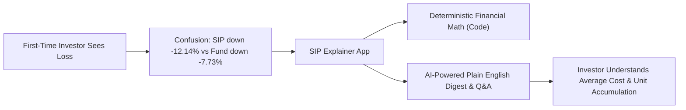
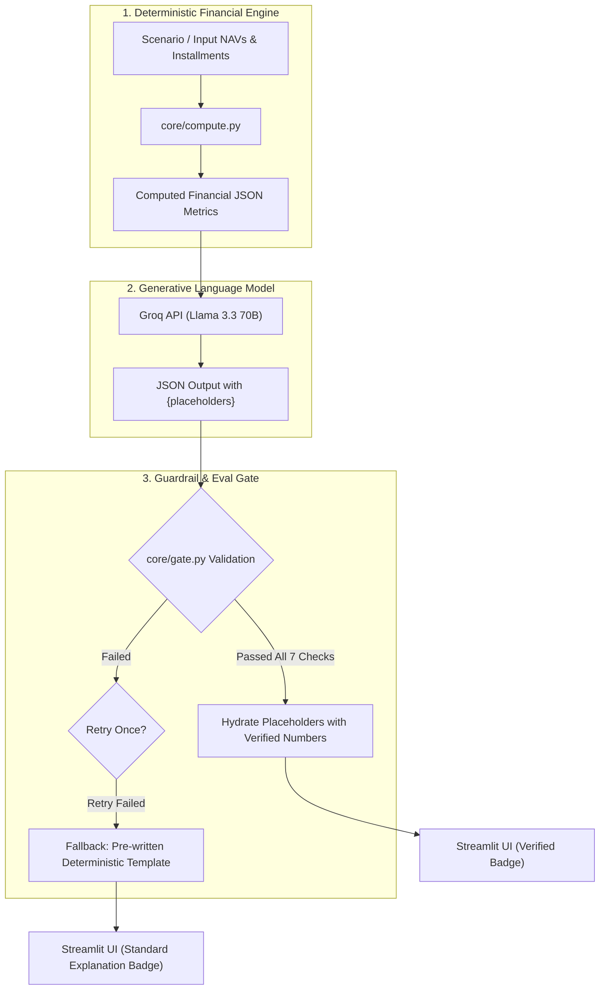
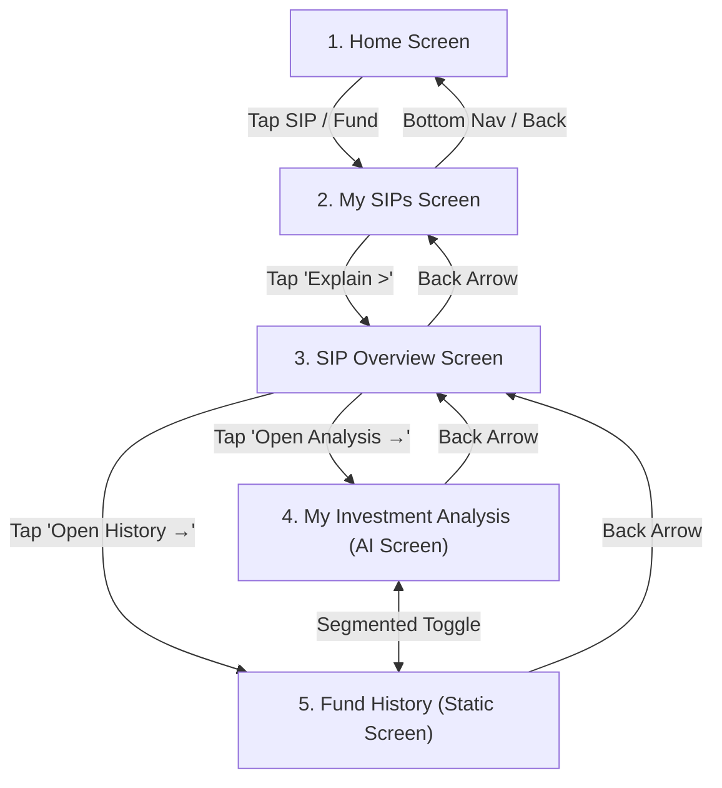
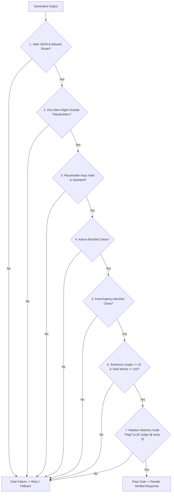
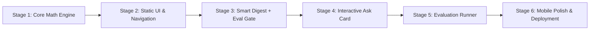

# Product Requirements Document & Problem Statement: "SIP Explainer"
**AI-Native Mutual Fund Explainer for First-Time SIP Investors (Groww Case Study)**

---

## 1. Executive Summary & Problem Overview

First-time mutual fund Systematic Investment Plan (SIP) investors frequently encounter a confusing psychological and mathematical dilemma: **their personal portfolio value sits below their invested capital, even when the underlying fund NAV is only slightly down or seemingly stable**.

### The Core Investor Dilemma
When an investor reviews public market performance or fund factsheets, they see point-to-point fund NAV returns calculated from a single lump-sum date. However, an SIP buys fund units across multiple separate dates at varying NAV price levels. If the market trended upwards during initial instalments and experienced a sharp drop near the valuation date, units accumulated at peak prices pull the investor's average purchase cost above current NAV—causing an SIP return of **-12.14%** while the fund's point-to-point return over the same period is only **-7.73%**.

### Product Mission
**"SIP Explainer"** is a deployed, AI-native mobile MVP designed to demystify SIP returns in plain English. It bridges the gap between raw financial mathematics and investor peace of mind, teaching the principles of rupee-cost averaging, unit accumulation, and unrealised versus realised performance without ever offering financial advice.



---

## 2. Core Architectural Principle: Strict Separation of Math and Language

> [!IMPORTANT]
> **Core Principle: Numbers come from code. The AI only writes words.**

1. **Deterministic Financial Math (`core/compute.py`)**: All financial metrics, unit allocations, average costs, return percentages, and chart vectors are calculated deterministically by Python code.
2. **Placeholder Generation (`core/llm.py`)**: The Large Language Model receives pre-computed metrics as JSON and is constrained to output placeholders (e.g., `{invested}`, `{value}`, `{diff}`, `{avg_cost}`, `{nav_now}`). **Any bare digit generated outside an allowed placeholder triggers an instant validation failure.**
3. **Gate Validation & Substitution (`core/gate.py`)**: The verification gate inspects the syntax, placeholders, and safety guardrails. Code safely interpolates the verified numbers before presenting the text to the user.



---

## 3. Strict Compliance Guardrails & Hard Constraints

The following constraints are strictly enforced in application code and validation gates, never relying on prompt instructions alone:

- **Zero Investment Advice**: Absolute ban on recommendations (no words such as *should*, *buy*, *sell*, *hold*, *switch*, *stop*, or *continue*).
- **Zero Market Predictions**: No price forecasting, speculative timelines, or guarantees of recovery.
- **Zero Fear or Urgency (FOMO)**: No sensationalised or panic-inducing vocabulary (e.g., *crash*, *danger*, *wipe out*, *alarming*, *hurry*).
- **Zero External Fund/Stock Recommendations**: Strict confinement to explaining the active SIP data.
- **No Third-Party Fund Ratings**: No CRISIL badges, star ratings, or comparative endorsements.
- **Mandatory Prominent Disclaimer**: The statement **"Educational explanation, not investment advice."** must be visible on every analysis screen, inside the Ask card, and in the persistent footer.
- **Design System Color Discipline**: Red (`#E5484D`) is restricted strictly to negative financial figures. UI cards, status strips, buttons, and chart elements must use neutral blue, grey, and green.

---

## 4. User Journey & Screen Navigation Flow

The application emulates a native mobile experience (max width ~420px, centered) with single-file routing managed by `st.session_state["screen"]`.



### Bottom Navigation & Header Rules
- **Top Bar**: Screen title, grey subtitle, help (`?`) icon, green avatar (`RS`), back arrow (present on all screens except Home).
- **Bottom Navigation**: Displays two primary tabs: **Home** and **My SIPs** (active tab highlighted in green). When viewing *SIP Overview*, *My Investment Analysis*, or *Fund History*, **My SIPs** remains highlighted in the bottom navigation.

---

## 5. Screen-by-Screen Detailed Specifications

### Screen 1: Home
- **Header**: Bold `"Hello!"` with subtitle `"Here's how your SIPs are doing"` (plain text), help icon, avatar `RS`. No empty padding above the portfolio card.
- **Portfolio Summary Card**: Dark green gradient card with `"TOTAL PORTFOLIO VALUE"`, aggregate value, pill `"+₹400 (+1.14%) overall"`, horizontal divider, and three metric columns: `Invested` | `Active SIPs` | `Monthly SIP`.
- **This Month Card**: Header `"THIS MONTH"` with green link `"View SIPs >"`. Card copy: `"Next investment ₹5,000 on 5 Dec, across 2 active SIPs"` with chevron leading to *My SIPs*.
- **Your Funds Section**: Two rows:
  - **Axis Bluechip Fund (AB)**: Value `₹12,300`, return `-12.14%` in red pill.
  - **Parag Parikh Flexi Cap Fund (PP)**: Value `₹23,100`, return `+10.00%` in green pill.
  - Tapping either row navigates to *My SIPs*.

---

### Screen 2: My SIPs
- **Intro Banner**: Mint card (`#E6F8F3`) titled `"Fund Performance Explainer"`: *"Confused by red or green numbers? Tap any SIP below to see plain-English explanations of your returns vs fund history."*
- **Active Section Header**: `"ACTIVE SIP INVESTMENTS (2)"` with a `"Tap to explore"` pill.
- **SIP Cards**:
  1. **Axis Bluechip Fund (Icon AB)**: Monthly `₹2,000`, green tag `"Active SIP"`, schedule `"Last instalment 5 Nov ✓ · Next 5 Dec"`, return pill `-12.14%`, label `"Unrealised difference/gain"`, Total Invested (`₹14,000` for 7 months), Current Portfolio Value (`₹12,300`). Neutral blue-grey strip at card bottom: `"See how your SIP works. Explain >"`. Tapping opens *SIP Overview*.
  2. **Parag Parikh Flexi Cap Fund (Icon PP)**: Monthly `₹3,000`, green tag `"Active SIP"`, schedule details, return pill `+10.00%`, Total Invested (`₹21,000`), Current Value (`₹23,100`). Tapping opens *SIP Overview* with static values and an MVP note: *"Detailed analysis is available for Axis Bluechip in this MVP"*.
- **Helper Note**: Grey caption: *"Your return can differ from the fund's return because you invest every month."*

---

### Screen 3: SIP Overview
- **Header**: Back arrow, title `"SIP Overview"`, fund dropdown selector (default: Axis Bluechip).
- **Summary Card**: Subtitle `"Monthly SIP: ₹2,000 • 7 instalments"`. 2x2 metric grid:
  - `Total Invested` (`₹14,000`)
  - `Current Portfolio Value` (`₹12,300`)
  - `Absolute Difference` (`-₹1,700` with red only on the number)
  - `Return Percentage` (`-12.14%` with red only on the number)
- **Growth Curve Chart**: *"Your 7-Month SIP Growth Curve"* plotting Invested (grey line) vs Portfolio Value (blue line) across M1 to M7 (`₹0` to `₹16k`) with dashed gridlines and shaded gap. Label: `"7 monthly deposits"`.
- **Yellow Clarification Card (`#FFF8E1`)**:
  > *"Why can your return differ from the fund's return? A fund's return over a period assumes one lump sum on day 1. Your SIP bought units 7 separate times at 7 different prices, so your return can differ. Here, the fund is down 7.73% while your SIP is down 12.14%."* (Metrics populated from `core/compute.py`).
- **Bifurcation Choices**: `"CHOOSE WHAT YOU WANT TO UNDERSTAND"`:
  - **Card 1 (Indigo `#4F46E5`, pill "Your Personal Money")**: *"1. Analyse My Investment: Understand how your actual cash contributions performed based on your deposit dates, 7 monthly instalments and annualised return."* Button `"Open Analysis →"` navigates to *My Investment Analysis*.
  - **Card 2 (Green `#00B386`, pill "Fund NAV History")**: *"2. Understand Fund History: Examine how this mutual fund behaved since you started and across 1Y, 3Y and 5Y market cycles, completely separate from when you invested."* Button `"Open History →"` navigates to *Fund History*.
- **Footer**: Grey text: *"Educational explanation, not investment advice."*

---

### Screen 4: My Investment Analysis (The Core AI Screen)

This is the **only screen** featuring live generative AI. Top-to-bottom layout:

```
+-------------------------------------------------------------+
| [<-] My Investment Analysis               Axis Bluechip     |
| [ My Investment (Active) ] | [ Fund History              ]  |
+-------------------------------------------------------------+
| Tester mode: [ base (7 instalments, dip)                v ] |
+-------------------------------------------------------------+
| SMART DIGEST (AI Explanation) [Badge: Numbers Verified]    |
| - What happened                                            |
| - What explains the observed movement                      |
| - What should the investor understand                      |
+-------------------------------------------------------------+
| ASK ABOUT YOUR SIP [AI ASSISTANT]                           |
| Chips: [Why is my SIP lower?] [What is avg cost?] ...       |
| Input: [ Ask in your own words                    ] [Send]  |
| (Interactive state: Checking -> Answered / Declined / etc.) |
+-------------------------------------------------------------+
| CHART: "Your SIP so far" (Invested grey, Value blue)        |
| Sub-chart: "Value minus invested" bar chart                 |
+-------------------------------------------------------------+
| STAT CARDS (2x2 Grid)                                       |
| Invested | Current Value | Total Diff | Avg Cost vs NAV     |
+-------------------------------------------------------------+
| TIMELINE BREAKDOWN (Months 1-4 vs Months 5-7 / Table)       |
+-------------------------------------------------------------+
| INVESTOR FUNDAMENTALS (5 Expanders: XIRR, Unrealised, etc.) |
+-------------------------------------------------------------+
| CORE TAKEAWAY (Green Callout Card)                          |
+-------------------------------------------------------------+
| [Expander: How we check this] [Expander: AI vs Standard]   |
+-------------------------------------------------------------+
| FOOTER DISCLAIMER                                           |
+-------------------------------------------------------------+
```

#### Detailed Components of Screen 4:
1. **Header & Toggle**: Subtitle `"Axis Bluechip Fund"`, chip `"Direct · Growth"`. Segmented toggle switch between `"My Investment"` and `"Fund History"`.
2. **Tester Mode Selector**: Small selector: `"Tester mode: try another sample SIP (this screen only)"`. Swapping scenarios alters Axis data **on this screen only** to maintain consistent demo pathways elsewhere.
3. **Smart Digest (Mint Card `#E6F8F3`)**:
   - Tag: `"AI explanation"`.
   - Content: Three structured sections:
     - *What happened*
     - *What explains the observed movement*
     - *What should the investor understand* (reminds the user that a difference only becomes a realised loss if units are sold).
   - Badge: `"Numbers verified against your SIP data"`.
   - Fallback: If verification fails twice, show standard template with badge `"Standard explanation (not AI-generated)"`.
   - Shield note: *"Mutual fund values fluctuate daily with market conditions."*
4. **"Ask about your SIP" Inline Fragment**:
   - Runs in `st.fragment` to prevent page-level reload/flicker.
   - Header with chat icon and mint pill `"AI ASSISTANT"`.
   - Quick chips: `"Why is my SIP lower than the fund?"`, `"What does average cost mean?"`, `"Is my money gone?"`.
   - Input field with green Send button.
   - **Dynamic Card States**:
     - **Checking State**: User query bubble plus animated dots: *"Checking numbers against your SIP data..."*
     - **Answered State**: User query, verified answer text, neutral chips for data cited (e.g., `"Invested ₹14,000"`, `"Avg cost ₹50.93"`), badge `"Numbers verified against your SIP data"`, expander `"How this was checked ▾"` detailing the 5 checks, thumbs up/down, tag `"AI-generated explanation"`, two follow-up query chips.
     - **Advice Declined State**: Soft indigo-bordered card, calm neutral tone, restates user numbers, three official regulatory resource links (Groww Help Centre, AMFI Investor Education, SEBI Investor Website). Badge: `"Not answered: investment advice"`.
     - **Prediction Declined State**: Calm notification stating future prices cannot be predicted; units remain intact while portfolio value moves with NAV.
     - **Not Sure State**: Grey-bordered card: *"I'm not sure from the data here"* with reference to official scheme factsheet. Badge: `"Not in your SIP data"`.
     - **Off-Topic Redirect State**: Single-line redirect with two relevant SIP chips.
     - **Fallback State**: Amber banner: *"We couldn't verify the generated answer, so here is our standard explanation."* Displays pre-written template with `"Standard explanation (not AI-generated)"` badge.
5. **Interactive Charting ("Your SIP so far")**:
   - Invested (solid grey line) vs Current Value (solid blue line) with shaded area.
   - Markers at month 1, peak gap month, and latest month.
   - Bar chart below: *"Value minus invested"* (blue above zero, grey below zero).
   - Dynamic annotation: *"Month N (NAV ₹X): your ₹2,000 bought Y units, the most of any month so far."*
6. **2x2 Stat Cards**:
   - Total Invested (`₹14,000`)
   - Current Value (`₹12,300` labelled `"units × NAV"`)
   - Total Difference (`-₹1,700`, `-12.14% absolute`, red only if negative)
   - Average Cost vs Current NAV (`₹50.93 vs ₹44.75`)
7. **Timeline Breakdown**:
   - For Base Scenario: Two highlighted blocks:
     - *Months 1-4*: NAV rose from ₹48.50 to ₹55.00 (+13.4%), invested ₹8,000, value ₹8,420 (badge: `"Your value +5.25%"`).
     - *Months 5-7*: NAV fell from ₹55.00 to ₹44.75 (-18.6%), invested ₹14,000, value ₹12,300 (badge: `"Your value -12.14%"`).
   - Other scenarios: Compact table highlighting the month with maximum units accumulated.
8. **Investor Fundamentals (5 Collapsible Expanders)**:
   1. *Invested vs Current Value*
   2. *Unrealised vs Realised*
   3. *XIRR (Annualised Return)*: Explicit rule: **XIRR is only displayed for scenarios with ≥12 instalments**; for shorter periods, it displays an explanation that annualising short horizons produces misleading figures.
   4. *NAV Fluctuations and Unit Accumulation*
   5. *Personal SIP Return vs Fund Return*
9. **Core Takeaway Card (Green)**:
   > *"Market movements naturally create phases where portfolio value sits above or below total contributions. Regular SIP investing focuses on accumulating units across varied market cycles without timing price levels."*
10. **System Transparency Expanders**:
    - Expander: *"How we check this"* (eval gate rules + dynamic table from `eval_results.json`).
    - Expander: *"What AI adds vs a standard explanation"* (toggle between AI-generated view and deterministic template view).
11. **Footer**: Mandatory disclaimer and market risk statement. No extraneous links like "Manage SIP" or "Download Statement".

---

### Screen 5: Fund History (Static, Non-AI)

> [!NOTE]
> Screen 5 is completely static. No LLM calls occur here, and no "AI-generated" or "Numbers verified" badges appear.

- **Header**: Title `"Fund Historical Performance"`, subtitle `"Axis Bluechip Fund"`, segmented toggle (Fund History active).
- **Intro Mint Card**: Explains fund NAV behavior across broad market cycles, entirely detached from personal deposit dates. No CRISIL badge.
- **Timeframe Selector Chips**: `Since you started (7M)` (default), `1Y`, `3Y`, `5Y`.
  - Green NAV curve with gradient fill and peak annotations (`₹55.00`).
  - Buttons: `"Top Growth Section"` and `"Top Decline Section"` highlighting specific time windows.
  - Interactive tooltip: *"Interactive Graph Inspector: Tap any point or use the buttons above to see how NAV reacted during specific periods."*
- **Fund History Summary Card**: Plain text analytical summary tailored to the active chip.
- **Disabled Preview Card ("Ask about this fund")**:
  - Grey pill: `"Coming soon"`.
  - Muted chips: `"Why did NAV fall from Aug to Nov?"`, `"What is drawdown?"`, `"Does a falling NAV mean the fund is failing?"`.
  - Disabled input with caption: *"Available on My Investment Analysis. Coming here next."*
- **Historical Behaviour Patterns**: Two rows (Rally window and Correction window). Note: strictly refrains from stating external macroeconomic causes (uses neutral phrasing: *"Market prices moved up and down during this period"*).
- **Fund Key Statistics (2x3 Grid)**:
  - Starting NAV | Current NAV | Period Return | Maximum Drawdown | Benchmark Nifty 50 (sample) | Risk Category (`"Very High"` in orange).
- **Educational Section: "Learn to read this graph"**:
  - *"What is NAV?"*
  - *"Does a falling NAV graph mean the fund is failing?"* (Answer: *"No. Markets fluctuate regularly due to economic cycles. A lower NAV lets your fixed monthly SIP buy more units, but it does not guarantee prices will recover."*)
- **Interactive Quiz Card (Navy `#1E1B4B`)**:
  - Question: *"A fund's NAV is down about 8% since you started, but your SIP is down about 12%. Why can this happen?"*
  - Option A: The fund charged a hidden penalty.
  - Option B: **Most of your instalments were bought at higher NAVs than the starting NAV** *(Correct)*.
  - Option C: SIP returns are always lower than fund returns.
  - Interactive evaluation shows instant explanation on selection.
- **Summary Takeaway**: Three bullet points ending with: *"Key Rule: Historical performance is useful for understanding past fund behaviour, but it does NOT guarantee future returns."*
- **Navigation Buttons**: `"← Back to My SIPs"` and `"Review SIP Overview →"`.

---

## 6. Financial Data & Scenarios

### 1. Default "Base" Scenario (Axis Bluechip Fund - AB)
- Monthly SIP: ₹2,000
- 7 Monthly Instalment NAVs (May - Nov 2023):
  `[48.50, 52.00, 54.00, 55.00, 53.95, 50.00, 44.75]`
- **Required Mathematical Outputs**:
  - Total Invested: **₹14,000**
  - Units Accumulated: **274.86**
  - Average Cost: **₹50.93**
  - Current Portfolio Value: **₹12,300**
  - Absolute Difference: **-₹1,700**
  - Personal SIP Return: **-12.14%**
  - Fund Point-to-Point Return: **-7.73%** (from 48.50 to 44.75)
  - Relation: `sip_lower` (SIP underperformed fund)
  - Timing: Last instalment 5 Nov 2023, valued 6 Nov 2023, next instalment 5 Dec 2023.

### 2. Static Portfolio Peer (Parag Parikh Flexi Cap Fund - PP)
- Monthly SIP: ₹3,000
- 7 Instalments
- Total Invested: **₹21,000**
- Current Portfolio Value: **₹23,100**
- Difference: **+₹2,100 (+10.0%)**

### 3. Aggregate Home Screen Totals
- Combined Total Invested: **₹35,000**
- Combined Portfolio Value: **₹35,400**
- Absolute Overall Return: **+₹400 (+1.14%)**
- Total Active SIPs: **2**
- Total Monthly Commitment: **₹5,000**
- Next Scheduled Investment: **₹5,000 on 5 Dec**

### 4. Golden Set Scenarios (10 Test Profiles)
Defined in `Evidence_Log/golden_set.json`:
1. `base`: 7 instalments, peak in middle, dip at end (SIP return lower than fund).
2. `rising`: Consistently rising NAV (average cost lower than current NAV).
3. `flat`: Constant NAV across all instalments (SIP return equal to fund return).
4. `falling`: Monotonically declining market (rupee-cost averaging in down market).
5. `v_shape`: Sharp dip and strong recovery.
6. `three_instalments`: Short 3-month history.
7. `small_sip`: Low ticket size (e.g., ₹500/month).
8. `large_sip`: High ticket size (e.g., ₹25,000/month).
9. `volatile`: Highly erratic month-to-month swings.
10. `twelve_instalments`: Full 12-month cycle enabling valid XIRR computation.

---

## 7. AI Engine Specification & Guardrail Eval Gate

### Single LLM Call per Question
- **Model**: Groq API with Llama 3.3 70B Instruct class.
- **Temperature**: `0.2`.
- **System Prompt Tone**: Calm, neutral, Grade 8 plain English (or simple Roman-script Hinglish if the user asks in Hinglish). Word count capped at 110 words.

### Input JSON Structure
```json
{
  "metrics": {
    "invested": "₹14,000",
    "value": "₹12,300",
    "diff": "-₹1,700",
    "return_pct": "-12.14%",
    "fund_return_pct": "-7.73%",
    "avg_cost": "₹50.93",
    "nav_now": "₹44.75",
    "nav_start": "₹48.50",
    "units_total": "274.86",
    "n_instalments": 7,
    "monthly": "₹2,000",
    "relation": "sip_lower"
  },
  "question": "Why is my SIP down more than the fund?",
  "glossary": {
    "nav": "Net Asset Value, unit price of the fund",
    "average_cost": "Total invested divided by total units accumulated",
    "rupee_cost_averaging": "Buying more units at lower NAVs and fewer units at higher NAVs"
  }
}
```

### Output JSON Schema
```json
{
  "route": "answer | decline_advice | decline_prediction | redirect_offtopic | not_sure",
  "answer": "Your SIP return of {return_pct} is lower than the fund's return of {fund_return_pct} because your {monthly} instalments bought units at an average cost of {avg_cost}, which is above today's NAV of {nav_now}."
}
```

### The 7-Step Eval Gate Pipeline



#### Detailed Gate Checks:
1. **JSON & Route Verification**: Must parse strictly into expected schema with one of the 5 allowed routes.
2. **Strict Digit Rule**: No digits `0-9` permitted outside of `{placeholders}`.
3. **Number Whitelist Check**: Once hydrated, every numerical value in the rendered prose must strictly match the pre-computed financial numbers.
4. **Advice Blocklist**: Zero matches on strings like `"you should"`, `"i recommend"`, `"buy"`, `"sell"`, `"switch to"`, `"redeem"`, `"stop your sip"`, `"continue your sip"`, `"better fund"`.
5. **Fear / Urgency Blocklist**: Zero matches on `"panic"`, `"crash"`, `"danger"`, `"hurry"`, `"last chance"`, `"losing everything"`, `"wipe out"`, `"disaster"`, `"alarming"`.
6. **Readability Gate**: Average sentence length ≤ 22 words; overall response ≤ 110 words.
7. **Semantic Relation Judge**: For explanation questions, an LLM judge (temperature `0.0`) validates that the stated relationship between personal SIP return and fund return accurately matches the `relation` flag (`sip_lower`, `sip_higher`, `equal`).

---

## 8. Logging, Evaluation & Telemetry

### Request Telemetry (`logs/requests.jsonl`)
Every inference request records one structured JSON line:
```json
{
  "timestamp": "2026-11-08T22:00:00Z",
  "scenario": "base",
  "question": "Why is my SIP lower than the fund?",
  "route": "answer",
  "checks_passed": [1, 2, 3, 4, 5, 6, 7],
  "checks_failed": [],
  "fallback_used": false,
  "latency_ms": 780
}
```

### Golden Set & Eval Runner (`eval.py`)
- Evaluates 32 test cases across 4 categories:
  - **Category A**: Explanations across varied market shapes.
  - **Category B**: In-scope investor questions (average cost, XIRR, units).
  - **Category C**: Adversarial queries testing guardrail refusals (advice, predictions, crypto/stock queries).
  - **Category D**: Out-of-bounds/facts not in data queries.
- **Target Performance Benchmarks**:
  - Numeric Accuracy: **100%**
  - Required-Facts Pass Rate: **≥ 95%**
  - Routing Accuracy on C & D Cases: **100%**
  - Advice-Language Rate: **0%**
  - Fear-Language Rate: **0%**
  - Readability Pass Rate: **≥ 95%**
  - Latency: **p50 < 1.2s, p95 < 2.5s**

---

## 9. Phased Implementation Roadmap



| Stage | Objectives & Key Deliverables | Verification Milestone |
| :--- | :--- | :--- |
| **Stage 1** | Implement `core/compute.py` and `core/static_data.py`. Write unit tests matching `golden_set.json`. | Unit tests pass with ±₹1 accuracy across all 10 scenarios. |
| **Stage 2** | Construct all 5 Streamlit screens with static content, layout, custom CSS, mobile 420px container, and bottom navigation. | Base figures verified on every screen; seamless navigation without flicker. |
| **Stage 3** | Integrate Groq LLM pipeline for the Smart Digest; implement `core/gate.py` with fallback templates in `core/templates.py`. | Smart Digest renders with verified badge or fallback on forced gate failure. |
| **Stage 4** | Implement the inline `"Ask about your SIP"` card inside `st.fragment`. Build all interactive states (Checking, Answered, Declined, Not Sure, Fallback). | Adversarial test questions ("Should I stop my SIP?") decline cleanly with official links. |
| **Stage 5** | Build `eval.py` runner; test all 32 golden set cases; output summary table and `eval_results.json`. | 100% numeric accuracy, 0% advice rate, and 100% routing accuracy verified. |
| **Stage 6** | Deploy application to Streamlit Community Cloud; verify end-to-end mobile responsiveness and zero full-page reload on phone browser. | Working public URL validated end-to-end on mobile viewport. |

---

## 10. Definition of Done Checklist

- [ ] **Data Integrity**: Base scenario reproduces `₹12,300` value, `-₹1,700` difference, `-12.14%` return, `274.86` units, `₹50.93` average cost, and `₹44.75` current NAV across all screens.
- [ ] **Portfolio Reconciliation**: Home portfolio cards reflect `₹35,000` invested, `₹35,400` current value, and `+₹400 (+1.14%)` unrealised gain.
- [ ] **Frictionless Navigation**: Complete routing loop functioning: `Home -> My SIPs -> SIP Overview -> My Investment Analysis <-> Fund History`, with responsive back navigation.
- [ ] **Zero Advice Compliance**: Advice prompts ("Should I sell?") trigger calibrated decline states with regulatory links (Groww, AMFI, SEBI).
- [ ] **Strict Gate Enforcement**: Any unverified or malformed model output triggers the deterministic fallback template.
- [ ] **No Hallucinated UI**: Fund History remains strictly static with no AI badges or claims.
- [ ] **Mobile Performance**: Centered 420px mobile viewport with zero full-page flicker during chat interactions (`st.fragment`).

